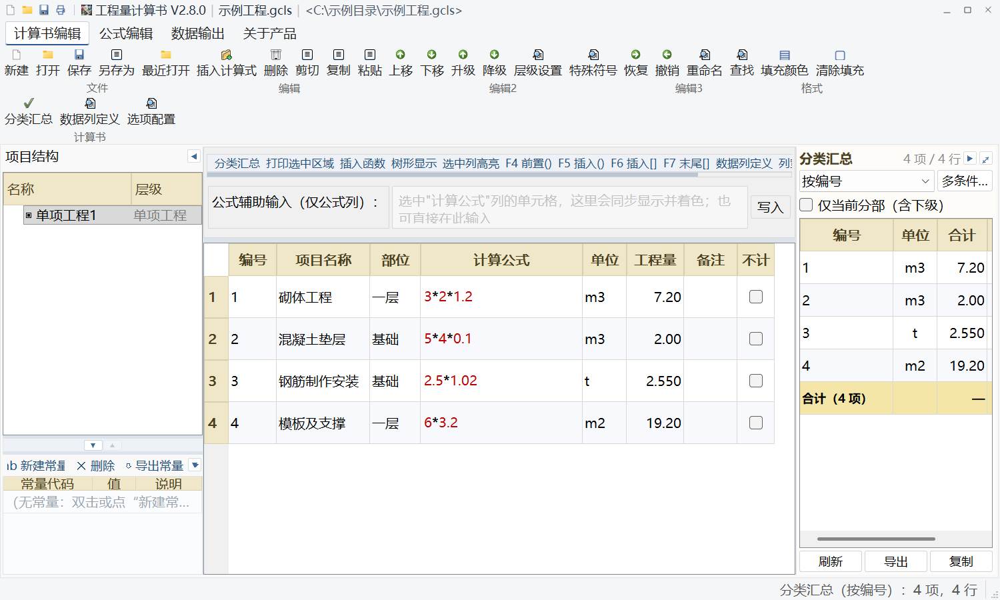

# 工程量计算书 CalcBook

> 基于 **Python + PyQt5** 的建筑工程量计算书工具 —— 分层目录、公式自动计算、单位精度控制、打印导出。
> 当前版本：**V5.0**（正式版）



---

## V5.0 正式版更新记录

这是 CalcBook 的**第一个正式版**，把 V4 系列的表格计算、汇总与打印能力整理成稳定形态。

### 一、表格计算

- **WPS 式列字母标尺**：每一列上方都有 A/B/C… 标尺，标尺哪一列写什么字母，公式就用什么地址（工程量 `E2`、计算公式 `F2`…）；序号列按行号参与引用（A1=1、A2=2…），清单编号这类文本不会被误当公式。**打开旧工程时公式地址自动换算**，计算结果不变，不需要手工改。
- **任意单元格之间可以直接运算**：备注列或自定义列里写 `=C3*B3` 就能算出结果，普通数字格也能参与计算。编辑公式时**点表格里的其它单元格即可插入引用**，按住 Shift 点可插入 `SUM(起点:终点)` 区间。
- **拖动填充越过末尾自动加行**：选中单元格右下角的填充柄往下拖，越过最后一行后虚框继续延伸，松手时自动在末尾追加相应行数并填入（一次最多 500 行，可 Ctrl+Z 撤销）。
- **增删列只作用于当前表**：某个计算书 / 明细表里添加的列，不会再让同一单项工程下所有表跟着加列。

### 二、汇总

- **单位工程工作区直接显示汇总表**：选中「单位工程」节点，右侧工作区切换成这个单位工程**直接下级**各表的汇总表（更深层的明细表不参与），第一列自动编号；可切换按编号 / 项目名称 / 部位 / 分部 / 单位 / 自定义列分组。
- **汇总支持多条件**：可同时勾**多个分组字段**（含自定义列），再加**多条筛选条件**（包含 / 不包含 / 等于 / 不等于 / 为空 / 不为空），条件之间选「满足全部 AND」或「满足任一 OR」。表头、序号、合计行、导出、复制、打印全部跟随。
- **汇总按「分部」顺着下来**：分组里带了分部时，**分部按它在树里的先后排列**（1罐基 → 2火车卸车泵棚 → 3防火堤隔堤），同一分部的组连成一整块，块内按编号自然序；以前一律按金额降序，同一分部被拆得到处都是，看着「汇总量是乱的」。
- 汇总表支持 **导出 Excel、复制（TSV，可直接粘到 WPS/Excel）、打印预览、打印…**，Ribbon 的导出 / 复制 / 打印按钮在工作区汇总表上也照样生效。

### 三、打印与报表

- **查看报表**先出表格化的工程量报表再打印，打印预览可正常打开。
- **页脚页码字号**改为按像素计算，与计算书正文字号一致（以前按点字号打印，页码「字特别大」）。
- **打印页码范围**真正生效：只勾一页就只打一页（打印前会先清掉打印机上残留的范围，避免重复过滤）。

### 四、界面

- **导航栏随时能回来**：工作区**左缘新增一条常驻窄条**，上面就是导航栏开关（`◀` 收起 / `▶` 展开）；Ribbon「编辑」组也有「导航栏」按钮（可勾选）。以前导航收起后唯一的展开入口藏在公式辅助栏里，而单位工程汇总视图会把那栏整个隐藏，一收起就再也回不去。
- **弹窗补齐窗口控制**：分类汇总窗口、查看报表窗口都有「最大化 / 还原」「返回主窗口」按钮，系统标题栏也补上了最小化 / 最大化键，不会再被最大化后整个屏幕盖住。

### 历史版本

V4.4 及更早的全部更新明细见 **[docs/changelog-legacy.md](docs/changelog-legacy.md)**；对应的源码 tag 仍保留在仓库里。

---

## 功能一览

### 目录与数据

| 功能 | 说明 |
| --- | --- |
| **多计算书** | 一份文件可建多个「单项工程」，第一个不可删除、可继续新增 |
| **四级层级** | 单项工程 → 单位工程 → 分部工程 → 分项工程，层级名称可在「层级设置」里自定义 |
| **自由增删** | 目录树右键可上移 / 下移 / 升级 / 降级，改动实时生效 |
| **删除全部数据** | 工作区左上角右键一键清空当前节点的行数据 |
| **查找** | 支持按**编号 / 项目名称 / 单位 / 部位**或自定义关键词查找 |

### 公式与计算

- **计算公式**列支持四则运算、括号、`+ - * /` 幂运算、面积/体积等常用组合。
- **F4 / F5 / F6 / F7** 快速插入 `() [] {} <> ` 四种括号。
- **公式辅助输入框**与表格双向实时同步；公式里的**数字、文字、符号分色显示**，和辅助窗颜色完全一致，方便逐项核对。
- **常量框**（左下）三列全自定义，常量可直接在公式里按名称引用，行高加大便于输入。
- **单位列 + 小数位**按单位自动判定精度（如 m³ 保留 3 位、m² 保留 2 位）。
- **不计**勾选框居中，勾选后该行不参与汇总。

### 编辑体验

- **撤销 / 恢复**：已修复，连续输入公式只算一步，可放心连续录入。
- **行高默认自适应、列宽默认使用固定宽度**（V3.6.0）：列宽不再随刷新 / 新增列被打乱；需要铺满窗口时点「列宽自适应」。
- **填充颜色**：单元格 / 整行 / 整列三级优先级。
- **面板可收起**：导航栏、分类汇总区、常量框都能一键收起，工作区瞬间变宽。
- **自动保存 + 备份目录**：默认备份目录 `D:\手算工程量计算书\bak`（启动自动创建，不再跟随工程文件目录），开启自动保存后可在备份目录找回带时间戳的历史副本；目录可在「选项配置」里改。

### 输出

- **打印预览**与**真实打印**分页完全一致，**每一页都重复显示表头**（按当前列顺序显示，默认：序号 / 编号 / 项目名称 / 单位 / 工程量 / 计算公式 / 图纸编号 / 大样图来源 / 不计 / 备注）。
- **导出 Excel**（.xlsx），列宽按界面比例还原。

### 界面

- **自绘标题栏**（取代 Windows 系统标题栏），左上角依次显示：橘黄底的软件图标 → 软件名称与版本 → 工程文件名称 → `<文件存放详细地址>`（用 `[...]` 包起来）；不再有常用函数快捷按钮。
- **软件图标**同时注册为 `.gcls` 工程文件的资源管理器图标，双击即可用本程序打开。


---

## 安装与运行

### 方式一：直接下载可执行文件（推荐给非技术用户）

下载 `工程量计算书V5.0.exe`（约 58MB），双击运行，免安装：

- [Gitee Release v5.0（点附件下载）](https://gitee.com/li993145/calcbook/releases/tag/v5.0)

> 本版本更新明细见 [RELEASE_NOTES_v5.0.md](RELEASE_NOTES_v5.0.md)。
>
> 历史版本（V4.4 及更早）的更新明细见 [docs/changelog-legacy.md](docs/changelog-legacy.md)，
> 对应的**源码 tag 仍保留在仓库里**（`git tag` 可查），只是不再单独发布下载页。

### 方式二：从源码运行

```bash
git clone https://github.com/li993145/calcbook.git
cd calcbook
pip install -r requirements.txt
python main.py
```

### 自行打包 exe

```bash
pip install pyinstaller
python build_exe.py
# 产物：dist/工程量计算书.exe
```

**环境**：Python 3.10+（开发验证于 3.13）、PyQt5 5.15、Windows 10/11。

---

## 使用速查

1. **新建 / 打开工程** → 工程文件后缀 `.gcls`，工程名只显示项目名，不带文件名与后缀。
2. **左侧目录树**右键 → 新增子级、改名、上移下移、升级降级。
3. **中间表格**录入：序号、编号、项目名称、单位、工程量（自动算）、计算公式、图纸编号、大样图来源、不计、备注；表头右键可增删 / 重命名列。
4. **公式**在「公式辅助输入框」里写，`Ctrl+Enter` 或点击辅助框的按钮回填到单元格。
5. **分类汇总**：在单元格里右键 →「分类汇总…」弹出汇总窗口。
6. **数据导出**页签 → 查看报表 / 导出表格 / 打印 / 打印预览 / 页面设置。

更详细的操作说明见仓库里的 [`使用说明.txt`](使用说明.txt)。

---

## 工程结构

```
calcbook/
├── main.py                # 主窗口、菜单/工具栏、表格、打印与导出
├── ui_ribbon.py           # Ribbon 页签、工具栏、自绘标题栏
├── ui_printpreview.py     # 打印预览画布 + 每页重复表头渲染器
├── ui_options.py          # 项目选项 / 选项配置 对话框（V3.7.0）
├── ui_report.py           # 查看报表窗口（V3.7.0）
├── core/
│   ├── model.py           # 工程 / 单项工程 / 分部 / 行 数据模型与工程文件格式
│   ├── formula.py         # 公式解析与求值
│   ├── highlighter.py     # 公式分色高亮（表格与辅助窗共用同一套颜色）
│   ├── units.py           # 单位与小数位规则
│   └── exporter.py        # 导出 Excel
├── build_exe.py           # PyInstaller 打包脚本
├── calcbook.ico / .png    # 软件图标（同时用于 .gcls 文件关联）
├── samples/示例工程.gcls   # 合成示例工程（不含真实项目数据）
├── docs/                  # README 用的截图
└── 使用说明.txt            # 完整中文操作手册
```

---

## 快捷键

| 快捷键 | 作用 |
| --- | --- |
| `Ctrl+S` | 保存工程 |
| `Ctrl+Z` / `Ctrl+Y` | 撤销 / 恢复 |
| `Ctrl+F` | 查找 |
| `Ctrl+P` | 打印 |
| `F9` | 插入计算式（在当前分部下插入一行） |
| `F4` / `F5` / `F6` / `F7` | 插入 `()` / `[]` / `{}` / `<>` |
| `Ctrl+Enter` | 公式辅助框内容回填到单元格 |
| `Ctrl+滚轮` | 表格字号缩放 |
| `Ctrl+C` / `Ctrl+V` | 项目结构树里复制 / 粘贴节点 |

---

## 常见问题

**Q：双击 `.gcls` 文件没反应 / 图标是白纸？**
A：程序在「关于产品」页可重新关联文件类型；资源管理器按 F5 刷新即可。也可直接把 exe 拖到 `.gcls` 文件上打开。

**Q：exe 双击闪退？**
A：程序会在 `%TEMP%\calcbook_error.log` 写下崩溃堆栈，把这个文件发出来即可定位。

**Q：打印出来第 2 页没有表头？**
A：V2.5 已修复，打印与预览都按「每页重复表头」绘制。

**Q：工程文件在哪？**
A：默认保存在你选择的位置，标题栏左上角会实时显示 `<完整路径>`。

---

## 许可

MIT License —— 见 [LICENSE](LICENSE)。

工程量计算书涉及规范与定额使用，请以现行国家/地方标准为准。
